# Company request workflow

The native Next.js, Python, and Go stack now has a company workspace at `/workspace`. Anduin is an optional example profile. Each company owns its product catalog, intake fields, team capabilities, approved knowledge, task priors, connectors, members, and delivery records.

```mermaid
flowchart LR
  A[Message and attachments] --> B[Extract text and evidence]
  B --> C[Retrieve approved company knowledge]
  C --> D[AI facts, product fit, gaps and questions]
  D --> E[Human scope review]
  E --> F[Task effort and assumptions]
  F --> G[Freeze immutable baseline]
  G --> H[Independent delivery review]
  H --> I[Training or declared holdout]
```



## Coverage

| Area | Backend | Workspace UI |
| --- | --- | --- |
| Intake | Authorized read-only Gmail polling, thread/message deduplication; signed form/CRM webhook; manual multipart upload | Inbox, connector authorization, sync status, retries, upload |
| Documents | PDF including OCR for up to 10 scanned pages, DOCX, XLSX, CSV, PPTX, EML, JSON, Markdown and text; encrypted originals; page/sheet/paragraph references; failures and truncation | Multiple files, extraction details, original download, incomplete-source acknowledgment |
| Classification | Demo, setup, migration, integration, customization, support | Editable classification and product fit |
| Scope | Typed configured fields, conditional requirements, owners, deliverables, exclusions, acceptance criteria and work packages | Human corrections, draft and confirmed scope |
| Knowledge | Approved immutable source versions, bounded lexical retrieval, cited passages, retrieval dates, digest; safe approved-domain fetching and 30-day refresh jobs | Draft, inspect, approve, retire, replace and search; refreshes become drafts and require approval |
| Configuration | Versioned fields, priorities, clarification prompts, products, capability profile, tasks, planning assumptions and domain allowlist | Admin settings, version history, explicit save |
| Effort | Configured task priors adjusted only by comparable independently approved recorded training outcomes; added scope excluded | Task calculations, adjustment factors, references, range and optional staffing scenario |
| Learning | Frozen source/config/estimate/knowledge; independent delivery approval; deterministic train/holdout split; recorded and synthetic cohorts separated | Baseline export, actuals submission, reviewer approval, evaluation and JSONL export |
| Access and operations | Verified first-party accounts; company membership and roles; encryption; configurable 1–3650-day request retention; startup and six-hour purge; bounded processing/retries; audit metadata | Members, processing state, error details, audit, request/company deletion and retention settings |

## Run locally

Use the private-workspace and identity setup in [local development](local-development.md). Set the ignored environment file's OpenAI key, internal service keys, database passwords, encryption key, and identity index key. Never rotate keys on an existing database without a migration.

```powershell
docker compose --env-file .env.local -f compose.yaml -f compose.identity.yaml -f compose.private-records.yaml up -d --build
```

Configure a real email delivery provider for account verification, or add the local Mailpit override described in the development guide. Open `http://localhost:3000/workspace`, sign in, and create a company. Save real company task priors or load the clearly labeled illustrative Anduin example and replace its fictional hours. Add and approve product documentation before analyzing a request.

The Python service performs OpenAI analysis only; no rule-parser fallback silently replaces a failed AI call. The worker starts when the private-workspace stack starts and checks configured mailboxes every five minutes between batches by default. It refreshes approved website sources every 30 days and saves each fetched version as a draft for administrator review. Each batch imports messages first, reloads the persisted queue, and starts analysis of newly received requests in the same batch. No browser, manual sync, or manual Analyze action is needed. Failed analysis retries up to three attempts with a delay; manual re-analysis is available. Searchable PDFs are read directly; scanned PDF pages use local English OCR with a 10-page OCR limit.

## Company-neutral knowledge contract

Retrieval uses approved source snapshots as retrieval-augmented generation (RAG). Customer attachments and public product documentation are separate evidence classes. Product matches need exact supporting quotes; unsupported statements remain unknown. Source fetching is explicit and restricted to the administrator's HTTPS domain allowlist, including redirects. Private/local IP destinations are rejected. Model output cannot issue network requests.

For portability, the system provides:

- REST/JSON endpoints for intake, company state, knowledge, evaluation, and export.
- JSON Schema 2020-12 at `GET /api/workflow/companies/{id}/schema` for each company's configured intake fields.
- A read-only Model Context Protocol (MCP) endpoint at `/api/workflow/companies/{id}/mcp`, using the official SDK and Streamable HTTP. Tools `knowledge_search` and `knowledge_fetch` and resources expose approved company knowledge only.

An administrator can generate a read-only MCP bearer token in Connectors. Copy it once, store it in the client's secret store, and send `Authorization: Bearer <token>`. Only its hash is retained; rotation/revocation and membership changes invalidate access. The endpoint also accepts the workspace's authenticated session. It does not implement an OAuth authorization-server discovery flow. This is a provisioned-token integration.

Knowledge transport is independent of retrieval implementation: a future vector store, enterprise search adapter, or internal documentation service can implement the same approved-passage contract. The current bounded lexical search is appropriate to the small local workspace; it is not semantic vector search.

## Gmail setup

1. Create a Google OAuth web client, enable the Gmail API, and configure the consent screen/test users as required by Google.
2. In Connectors, save the client ID and secret and register the displayed redirect URI with Google.
3. Choose a query for client request emails and authorize `gmail.readonly`. Automatic import and analysis start while the services are running. Existing matching emails are included on the first scan.

Messages and replies are grouped by Gmail thread ID; immutable message IDs prevent repeat imports. Replies invalidate uncompleted scope reviews. A reply after a delivered request becomes a separate follow-up request. Polling checkpoints overlap by five minutes and restart idempotently if pagination fails. Mailbox credentials are encrypted and available only through internal connector-scoped requests. Disconnect revokes the Google grant when reachable and removes local tokens.

Application login and Gmail authorization are separate. Signing in with an email address does not grant inbox access.

For the emailed test pack, use `subject:EST-MOCK-20261019-01` as the query. For normal use, configure a dedicated Gmail label or client sender/subject query. Broad `in:inbox` imports every matching inbox message. Provider errors appear on the request; an invalid OpenAI key does not become a successful analysis.

`WORKFLOW_POLL_INTERVAL_MS` configures the worker interval (10,000–300,000 milliseconds, default 300,000). Docker uses `restart: unless-stopped`. The app and worker must remain running on the server; a stopped laptop cannot receive background work.

This implementation uses polling. Instant delivery via Gmail push requires a separately configured Google Cloud Pub/Sub topic, subscription and mailbox watch, including watch renewal and periodic synchronization for missed notifications. See [Google's push notification guide](https://developers.google.com/workspace/gmail/api/guides/push). Pub/Sub is not configured by this local change.

## Demo forms and CRM adapters

The public demo page cannot expose submissions. Its owner must configure the form provider, CRM, or notification inbox. No access to Anduin's submission system is assumed.

Generate a signing secret in Connectors. Submit JSON to `POST /api/workflow/inbound/{companyId}`:

```json
{
  "submissionId": "stable-provider-submission-id",
  "title": "Integration inquiry",
  "text": "Please connect our CRM contacts to the investor portal.",
  "attachments": [
    {"name": "brief.txt", "contentType": "text/plain", "contentBase64": "<base64 bytes>"}
  ]
}
```

Headers: `Content-Type: application/json`, `X-Workflow-Timestamp: <RFC3339 UTC>`, and `X-Workflow-Signature: <hex HMAC-SHA256>`. Sign the exact bytes `timestamp + "." + rawBody` with the company secret. Timestamps expire after five minutes. Replaying an unchanged submission ID returns the existing request; changed payloads create a source revision. Keep secrets on the sending server. Rotation invalidates the previous secret.

## Delivery and evaluation

Freeze before delivery. Record original task hours and additional scope separately, with evidence and a different designated reviewer. The server rejects self-approval and ignores client assertions of eligibility. Only independently approved recorded training outcomes can affect task adjustment. Holdout assignment uses a stable hash namespace and is captured in the baseline before outcome performance is examined.

The request workspace presents a provisional AI work breakdown with source quotations or an explicit inference label. A reviewer edits and confirms deliverables, exclusions, acceptance criteria, dependencies, owners, and task packages before effort is calculated. Numeric task ranges come from configured priors and eligible training deliveries, not the language model. Freezing the reviewed estimate creates the immutable commitment baseline. Per-task assignee, status, planned dates, and progress notes are stored separately and audited; they do not rewrite the baseline.

Evaluation reports base/adjusted absolute error, signed bias, observed range coverage, domain counts, exclusions, and sample limitations. Exported JSONL is compatible with the existing [holdout evaluator](../evaluation/README.md). Synthetic demonstrations remain separate. A measured count is descriptive; it does not prove representativeness or improvement. Issue #39 still needs real eligible recorded holdout outcomes.

## Current operational limits

- Ten files, 10 MB per file, 20 MB total per request; 20,000 extracted characters per file, 90,000 across attachments, and 100,000 message characters. Failures/truncation are visible and require reconciliation.
- OCR is limited to English and 10 scanned pages per PDF. Legacy binary DOC/XLS, password-protected files, and nested EML attachments need conversion or separate upload.
- A company aggregate is bounded to 200 requests, 200 knowledge versions and 16 MB of encrypted JSON. This is a local prototype storage boundary, not a high-volume mailbox archive.
- Staffing projections use allocated people, configured daily hours, dependency delay, and weekdays. The optional finish date excludes weekends but does not consult a real staffing calendar or holidays.
- Google authorization, a real submission provider, live email delivery, and representative recorded delivery data require the respective owner's setup/data. Local tests cannot verify those external accounts.
- The hosted Sites application has its own company workflow and GitHub release artifact. See [Sites deployment and coverage](sites-release.md) for its supported adapters, roles, webhooks, MCP and delivery review. The native processes described here remain a separate deployment target; Sites Gmail polling is deferred.
